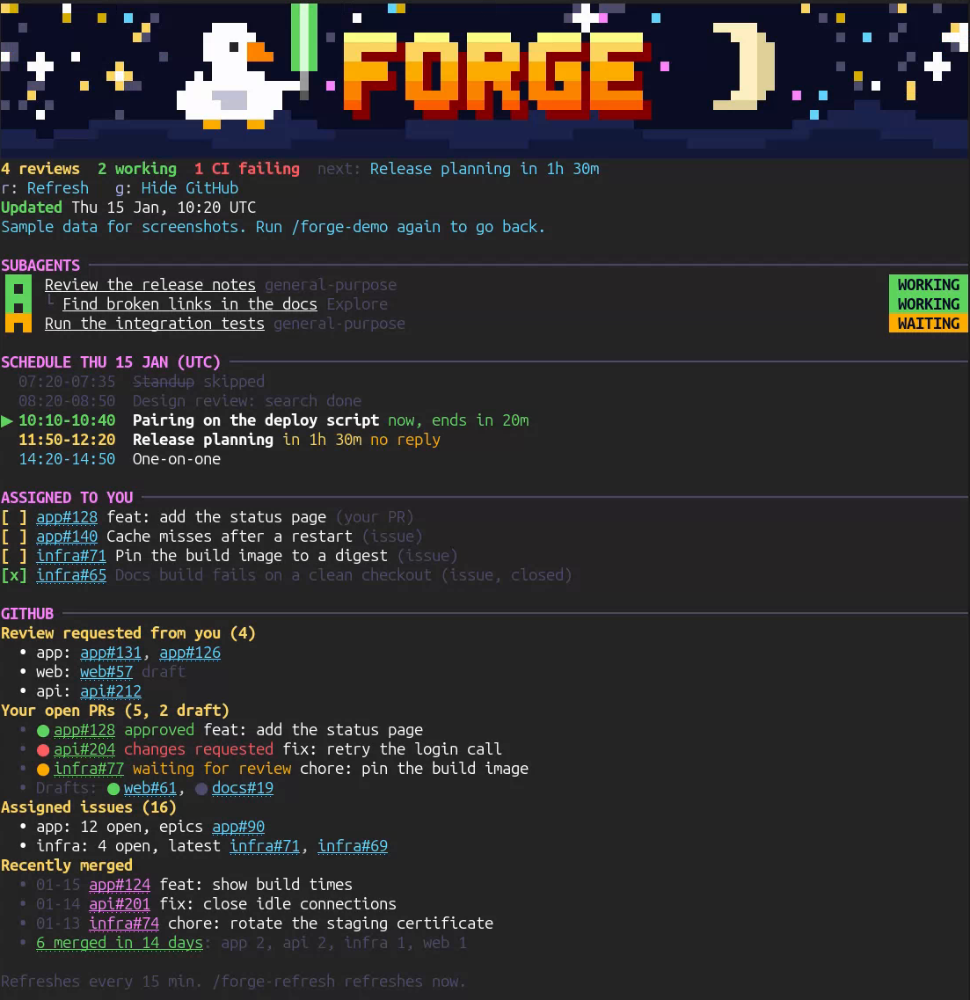

# Forge

Forge is a Claude Code mod. It draws a status board in a pane beside the chat.



- A pixel art banner: a starry night with a duck that holds a lightsaber, the word FORGE and a crescent moon. By day the sky turns blue, with a sun and clouds.
- A summary line: review requests, running subagents, failing CI and your next meeting.
- Subagents: the subagents of this session, with their status. Click a row to open its transcript.
- Schedule: today's meetings from Google Calendar, with a line for the current time.
- Assigned to you: your assigned PRs, the issues you touched last, and issues closed lately.
- GitHub: review requests, your open PRs with CI and review state, assigned issues, and merges from the last 14 days.

Forge refreshes every 15 minutes. It reads the subagents every 5 seconds. It shows a toast and a desktop notification when a review request arrives, CI fails on one of your PRs, a subagent finishes or fails, or a meeting starts in 5 minutes.

## Install

At the prompt of a terminal session:

```
/plugin install forge --marketplace girdharshubham/forge
```

From a shell:

```
claude plugin install forge --marketplace girdharshubham/forge
```

In the desktop app, where `/plugin` does not run: click + next to the prompt box, then Plugins, Add marketplace with `girdharshubham/forge`, then Add plugin.

## Requirements

- The GitHub CLI, `gh`, signed in. Forge only reads from GitHub.
- The Google Calendar connector, for the schedule. Without it the schedule says so and the rest of the board works.
- The fullscreen renderer, so the pane docks beside the transcript: run `/tui fullscreen` and start Claude Code again.

## Options

Set these when you install, or later in the config menu.

| Option | What it sets | Default |
| --- | --- | --- |
| GitHub orgs | Comma-separated orgs or users to search. Empty searches all of GitHub. | empty |
| Time zone | The IANA time zone for the schedule and the banner, such as `Europe/Berlin`. Empty uses this computer's time zone. | empty |
| Time zone label | The short name shown next to times, such as `CET`. Empty uses this computer's short name, or the time zone when you set one. | empty |
| Repo short names | Comma-separated `owner/repo=name` pairs that shorten long repository names. | empty |

## Support Forge

Forge is free. If it saves you time, you can sponsor its upkeep at https://github.com/sponsors/girdharshubham.

## License

Apache-2.0. See `LICENSE`.

## Use

- `/forge` opens the pane.
- `/forge-refresh` refreshes the board now.
- `/forge-demo` fills the pane with sample data, for screenshots and demos. Nothing real is read or shown while it is on. Run it again to go back.
- In the pane, `r` refreshes and `g` hides or shows the GitHub section.
- Click the duck, or press `d`, and it shows you some lightsaber-fu.
